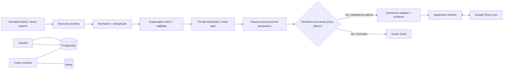

# BruteApply

**An owner-controlled job-search operations platform** for discovering, evaluating and tracking IT opportunities. BruteApply combines explainable matching, private document management, ticketed human decisions and an auditable application lifecycle.

> **Status:** foundation build. Demo mode uses synthetic data only. Production integrations and the protected production hostname are not activated. Real autonomous submission is disabled.

## Why it exists

Job-search work is spread across postings, resumes, applications, follow-ups, recruiter messages and a tracker. BruteApply brings those tasks into one queue while keeping eligibility rules deterministic, decisions explainable and uncertain or sensitive steps in an owner ticket.

## Current implementation

- FastAPI service with Cloudflare Access JWT validation required outside demo mode.
- PostgreSQL schema/migrations for profiles, verified facts, jobs, matches, applications, documents, tickets, integrations, workers and audit events.
- Redis-backed Celery task boundary with bounded retries and late acknowledgements. Provider task bodies deliberately fail closed until terms-reviewed adapters are implemented; no discovery, sync, document generation or submission worker is active.
- Deterministic job normalization, fingerprinting, hard-blocker checks and explainable scoring.
- Safe submission-policy gate: unknown facts, sensitive declarations, access controls, CAPTCHA/MFA, duplicate history or unsupported automation stop the flow and create a ticket.
- Synthetic-data dashboard for local exploration. Demo mode cannot contact the production database, Google, email, OpenAI or job providers.
- The canonical resume source is preserved outside this repository. A verified encrypted local copy exists in owner-only state; it has not been imported into a production database. No personal profile, real application, document or credential is included here.

## Architecture



The intended private deployment is Cloudflare Access → exact `jobapply.brutehack.com` route → BruteHost private proxy → frontend/API, with private PostgreSQL, Redis and document storage. No wildcard route or public database/cache port is used.

See [ARCHITECTURE.md](docs/ARCHITECTURE.md), [SECURITY.md](docs/SECURITY.md), [THREAT-MODEL.md](docs/THREAT-MODEL.md), [DEPLOYMENT.md](docs/DEPLOYMENT.md), [OPERATIONS.md](docs/OPERATIONS.md), [RECOVERY.md](docs/RECOVERY.md), [GOOGLE-SHEETS.md](docs/GOOGLE-SHEETS.md), [JOB-SOURCES.md](docs/JOB-SOURCES.md), [APPLICATION-POLICY.md](docs/APPLICATION-POLICY.md), [AI-SAFETY.md](docs/AI-SAFETY.md), and [PRIVACY.md](docs/PRIVACY.md).

## Development

Requirements: Docker Compose v2, Node.js 20.9+, Python 3.12+, and a local PostgreSQL/Redis pair. For a synthetic-data demo, no third-party credentials are needed.

```bash
docker compose -f deploy/compose.demo.yaml up --build
```

The demo Compose stack uses synthetic records, an internal-only network and no host ports. Production requires generated secret files, Cloudflare Access application/audience, reviewed migrations, private persistent volumes, monitoring and an owner-approved activation boundary. Do not point demo mode at production services.

## Safety and privacy

- Public source contains no real resume, profile, sheet rows, recruiter correspondence or application data.
- Demo providers are synthetic and cannot perform external writes.
- Production mode rejects requests without a valid exact-app Cloudflare Access JWT and owner email allowlist.
- Real submission is hard-disabled unless a separate runtime policy enables it after the one-time owner activation gate.
- External job postings, websites and email are untrusted input. They cannot alter policy or trigger tools.
- Google Sheet is an owner-facing projection, not the operational source of truth. Formula cells and existing tabs are preserved.
- Production backups are **DEFERRED / NOT IMPLEMENTED** until a BruteHost destination and restore test exist.

## License

MIT. Third-party dependencies retain their own licenses.
