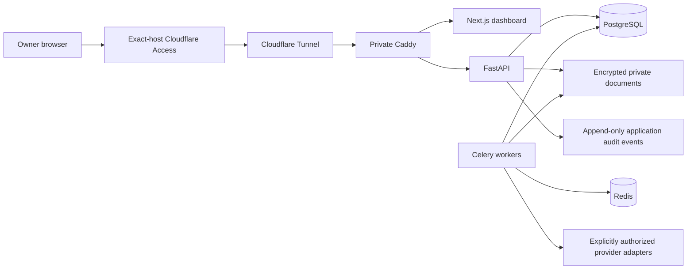

# BruteApply architecture

## Runtime boundary

The intended private runtime is Cloudflare Access on the exact `jobapply.brutehack.com` hostname, Cloudflare Tunnel, the existing private Caddy layer, a Next.js dashboard, FastAPI API, PostgreSQL, Redis/Celery workers, and encrypted private document storage. The application does not use Docker socket access. PostgreSQL, Redis, and application ports remain internal. This architecture is **designed**, not deployed.

## Implemented in source

- FastAPI API foundation, exact Access JWT issuer/audience/owner validation, demo fixtures, health/readiness endpoints, private encrypted profile and PDF storage primitives, manual job import, idempotent job normalization, ticket state transitions, emergency-stop endpoint, and PostgreSQL schema.
- Next.js responsive operational dashboard with synthetic demo records only.
- Deterministic matching and eligibility gates. Autonomous submission defaults disabled.
- Celery worker boundary configured with late acknowledgements, bounded prefetch, retry/backoff and JSON-only task serialization. Provider jobs intentionally fail closed until a permitted integration is configured.
- PostgreSQL is intended as operational source of truth. The existing Sheet is a compatible owner-facing projection.

## Not yet active

No production runtime, owner Access application, production database, Redis broker, job provider, Google OAuth, email/calendar OAuth, OpenAI key, or external submission adapter is activated by this repository. No real application is submitted. The canonical resume is kept outside Git in owner-private local storage and has not been written to a production database.

## Data boundaries

Candidate facts, contact records, application notes, screening answers, integration state, email content and documents are private. Documents are AES-256-GCM encrypted before writing, with random storage identifiers and per-document authenticated data. Metadata stores hashes and a private opaque storage key. Key rotation and secure recovery require an independently protected key backup; production backup is currently deferred.

All external job/email content is untrusted. Deterministic policy remains authoritative over AI extraction or recommendations. No model output can approve eligibility, resolve a sensitive question or bypass a CAPTCHA, MFA, authentication or platform policy.
